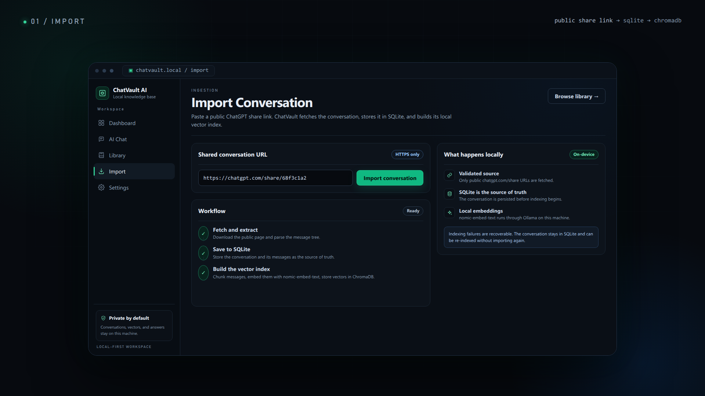
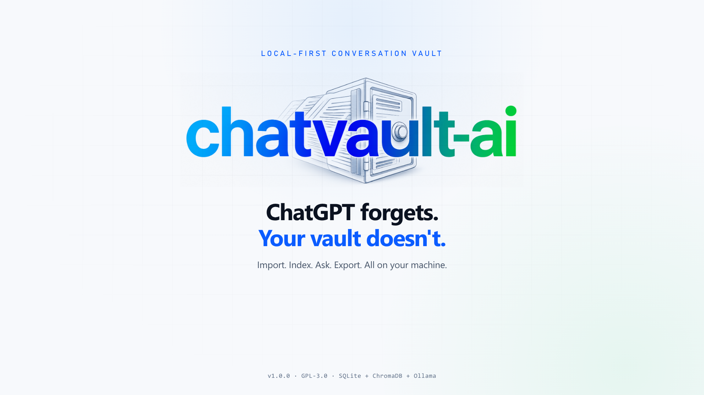
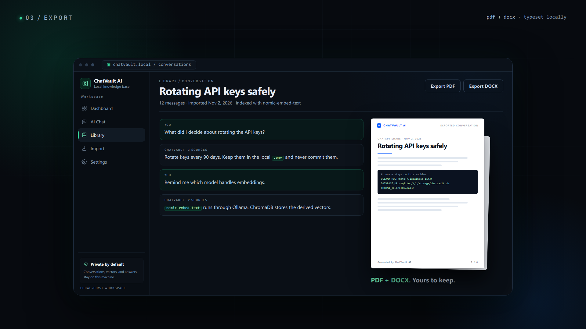
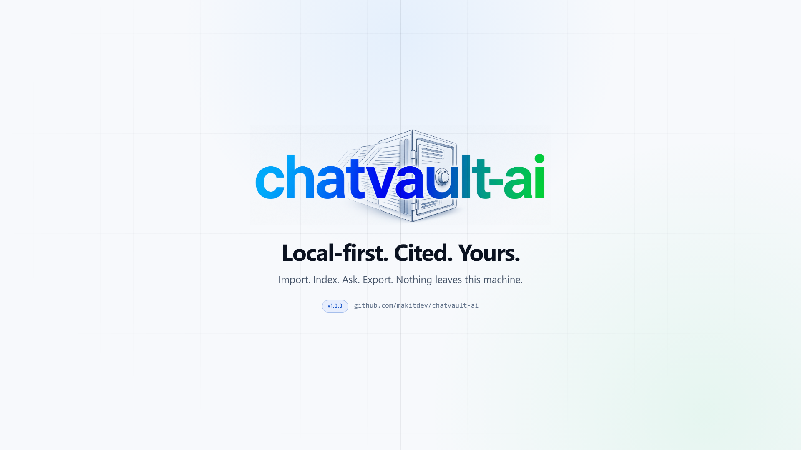
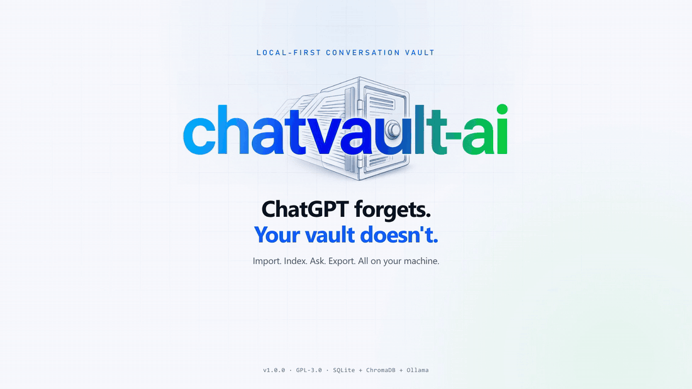
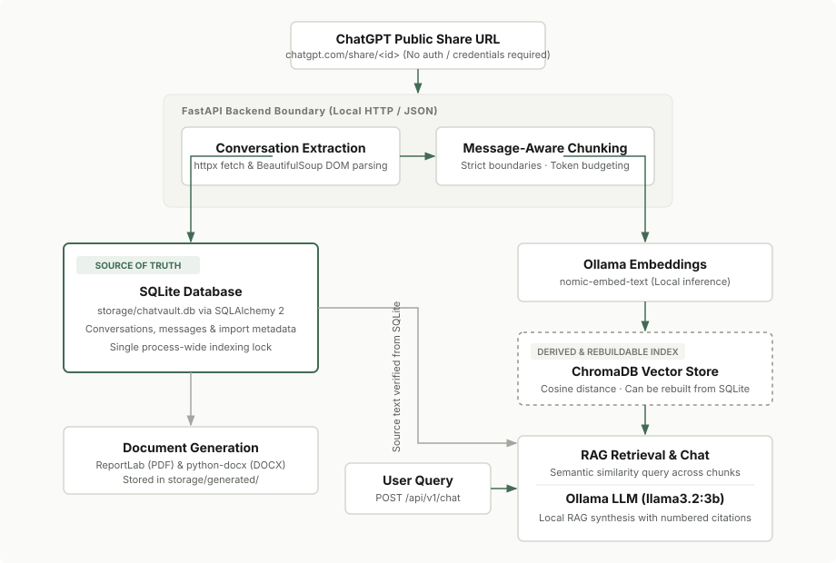

<div class="cv-home" markdown>

<div class="cv-hero" markdown>

<h1 class="cv-hero__title">Your conversations.<br>Your knowledge. Your control.</h1>

<p class="cv-hero__desc">
ChatVault AI is a local-first conversation knowledge base that turns public ChatGPT conversations
into a locally searchable vault. Retrieve meaningful context, ask questions with verified
citations, and export structured documents without cloud dependencies.
</p>

<div class="cv-hero__actions">
  <a href="getting-started/index.md" class="cv-btn cv-btn--primary">Explore documentation</a>
  <a href="https://github.com/makitdev/chatvault-ai" class="cv-btn cv-btn--secondary" target="_blank" rel="noopener">View on GitHub</a>
</div>

<div class="cv-preview" data-ui markdown>
<div class="cv-preview__header">
  <span>chatvault-terminal &mdash; local RAG verification</span>
  <span>SQLite + Ollama (offline)</span>
</div>
<div class="cv-preview__body" markdown>

```bash
# Query the local vault with source-grounded citations
$ curl -X POST http://127.0.0.1:8000/api/v1/chat \
  -H "Content-Type: application/json" \
  -d '{"query": "How does ChatVault store conversations?", "top_k": 3}'

{
  "answer": "ChatVault stores all conversations and messages locally in SQLite as the immutable source of truth. ChromaDB stores derived embeddings generated via Ollama (nomic-embed-text) and can be rebuilt at any time.",
  "citations": [
    {"source_id": 1, "chunk_id": "conv_92a_chunk_0", "similarity": 0.894, "conversation_title": "Local Storage & RAG Architecture"}
  ]
}
```

</div>
</div>

</div>

## Core capabilities

<ul class="cv-capabilities" markdown>
<li class="cv-capability" markdown>
<div class="cv-capability__thumb">
  
</div>
<h3 class="cv-capability__title">Import conversations</h3>
<p class="cv-capability__text">Import public ChatGPT share links and extract structured conversation messages with duplicate detection.</p>
</li>

<li class="cv-capability" markdown>
<div class="cv-capability__thumb">
  
</div>
<h3 class="cv-capability__title">Build your knowledge base</h3>
<p class="cv-capability__text">Store conversation trees in SQLite and generate vector embeddings locally using Ollama nomic-embed-text.</p>
</li>

<li class="cv-capability" markdown>
<div class="cv-capability__thumb">
  
</div>
<h3 class="cv-capability__title">Search and ask</h3>
<p class="cv-capability__text">Retrieve relevant conversation passages via cosine search and synthesize answers with numbered citations.</p>
</li>

<li class="cv-capability" markdown>
<div class="cv-capability__thumb">
  
</div>
<h3 class="cv-capability__title">Export documents</h3>
<p class="cv-capability__text">Generate styled PDF and editable DOCX transcripts complete with code blocks, tables, and task lists.</p>
</li>
</ul>

<figure class="cv-demo-frame" markdown>
  <video controls autoplay loop muted playsinline poster="assets/images/screens/demo-poster.jpg">
    <source src="assets/videos/demo.mp4" type="video/mp4">
    
  </video>
  <figcaption>Authentic product demonstration: import a public share link, index it locally, query with source citations, and export the transcript.</figcaption>
</figure>

## Technical architecture

ChatVault AI adheres to one strict architectural principle: **SQLite is the source of truth, and ChromaDB is a derived, rebuildable index.**

```
ChatGPT Public Share URL
           |
           v
    FastAPI Backend
           |
           v
Conversation Extraction
           |
           v
Text Processing and Chunking
           |
   +-------+-------+
   |               |
   v               v
 SQLite          Ollama
Source of Truth  Embeddings
   |               |
   |               v
   |            ChromaDB
   |         Derived Index
   |               |
   +-----> RAG Retrieval
                   |
                   v
               Ollama LLM
                   |
                   v
           Answer + Citations
```

<div class="cv-architecture" markdown>

</div>

The FastAPI backend is the only process that connects to external share URLs, SQLite, Ollama, and ChromaDB. The React frontend interacts solely over HTTP JSON APIs.

* **SQLite (`storage/chatvault.db`):** Authoritative storage for conversations, messages, and indexing state. Protected by a single process-wide lock.
* **ChromaDB (`storage/chroma`):** Ephemeral vector index for cosine-distance nearest-neighbor search. Can be deleted and rebuilt from SQLite at any time.
* **Ollama (Local Runtime):** Handles all vector embeddings (`nomic-embed-text`) and inference (`llama3.2:3b`). No conversation content or prompts leave your machine.

Detailed failure boundaries and concurrency models are documented in [Architecture Concepts](concepts/architecture.md).

## Technology stack

ChatVault AI utilizes an open, strictly local technology stack with no cloud dependencies.

<div class="cv-tech-matrix" markdown>

<div class="cv-tech-group" markdown>
<h4 class="cv-tech-group__title">Frontend</h4>
<ul class="cv-tech-group__list">
  <li><strong>React 19 &amp; Vite 8</strong> <span class="cv-tech-group__sub">&mdash; Fast local UI</span></li>
  <li><strong>TypeScript &amp; Tailwind CSS 4</strong> <span class="cv-tech-group__sub">&mdash; Type safety &amp; layout</span></li>
  <li><strong>TanStack Query 5</strong> <span class="cv-tech-group__sub">&mdash; Server-state caching</span></li>
  <li><strong>React Router 7</strong> <span class="cv-tech-group__sub">&mdash; Client-side routing</span></li>
</ul>
</div>

<div class="cv-tech-group" markdown>
<h4 class="cv-tech-group__title">Backend</h4>
<ul class="cv-tech-group__list">
  <li><strong>FastAPI &amp; Uvicorn</strong> <span class="cv-tech-group__sub">&mdash; Asynchronous REST API</span></li>
  <li><strong>Pydantic v2</strong> <span class="cv-tech-group__sub">&mdash; Request &amp; schema validation</span></li>
  <li><strong>httpx &amp; BeautifulSoup4</strong> <span class="cv-tech-group__sub">&mdash; Resilient share scraping</span></li>
</ul>
</div>

<div class="cv-tech-group" markdown>
<h4 class="cv-tech-group__title">Database &amp; Storage</h4>
<ul class="cv-tech-group__list">
  <li><strong>SQLite &amp; SQLAlchemy 2</strong> <span class="cv-tech-group__sub">&mdash; Relational source of truth</span></li>
  <li><strong>ChromaDB 1.5.9</strong> <span class="cv-tech-group__sub">&mdash; Disposable vector store</span></li>
</ul>
</div>

<div class="cv-tech-group" markdown>
<h4 class="cv-tech-group__title">AI &amp; Embeddings</h4>
<ul class="cv-tech-group__list">
  <li><strong>Ollama</strong> <span class="cv-tech-group__sub">&mdash; Local AI runtime engine</span></li>
  <li><strong>nomic-embed-text</strong> <span class="cv-tech-group__sub">&mdash; 768-dim local embeddings</span></li>
  <li><strong>llama3.2:3b</strong> <span class="cv-tech-group__sub">&mdash; Cited RAG answer synthesis</span></li>
</ul>
</div>

<div class="cv-tech-group" markdown>
<h4 class="cv-tech-group__title">Document Generation</h4>
<ul class="cv-tech-group__list">
  <li><strong>ReportLab</strong> <span class="cv-tech-group__sub">&mdash; Styled PDF rendering</span></li>
  <li><strong>python-docx</strong> <span class="cv-tech-group__sub">&mdash; Editable DOCX generation</span></li>
</ul>
</div>

<div class="cv-tech-group" markdown>
<h4 class="cv-tech-group__title">Testing &amp; Quality</h4>
<ul class="cv-tech-group__list">
  <li><strong>pytest &amp; pytest-asyncio</strong> <span class="cv-tech-group__sub">&mdash; Backend API testing</span></li>
  <li><strong>oxlint &amp; tsc</strong> <span class="cv-tech-group__sub">&mdash; Frontend validation</span></li>
</ul>
</div>

</div>

## Feature status

The status table below reflects the implementation status in the `v1.0.0` release.

| Capability | Status | Implementation Details |
| :--- | :--- | :--- |
| Public ChatGPT share URL import | <span class="cv-badge cv-badge--implemented">Implemented</span> | `chatgpt.com/share/<id>` extraction; duplicate detection |
| SQLite conversation and message storage | <span class="cv-badge cv-badge--implemented">Implemented</span> | Source of truth; duplicate imports return the existing record |
| Conversation library and viewer | <span class="cv-badge cv-badge--implemented">Implemented</span> | Title filter, date/message filters, sorting, Markdown transcript |
| PDF and DOCX export | <span class="cv-badge cv-badge--implemented">Implemented</span> | Per conversation, generated from the viewer or REST API |
| Message-aware chunking | <span class="cv-badge cv-badge--implemented">Implemented</span> | Chunks respect message boundaries; token budgeting |
| Ollama embeddings and ChromaDB index | <span class="cv-badge cv-badge--implemented">Implemented</span> | Explicit embeddings only; cosine distance vector search |
| Per-conversation and bulk indexing | <span class="cv-badge cv-badge--implemented">Implemented</span> | Synchronous execution; single process-wide indexing lock |
| Index status, delete, and rebuild | <span class="cv-badge cv-badge--implemented">Implemented</span> | Rebuild recreates the ChromaDB collection from SQLite |
| Semantic search | <span class="cv-badge cv-badge--api">API only</span> | `POST /api/v1/search`; no dedicated frontend search screen |
| Retrieval-augmented chat | <span class="cv-badge cv-badge--implemented">Implemented</span> | Cited sources; no-source path skips the chat model |
| Dashboard and system status | <span class="cv-badge cv-badge--implemented">Implemented</span> | SQLite record counts, index coverage, Ollama &amp; ChromaDB health |
| Single-user local access | <span class="cv-badge cv-badge--implemented">Implemented</span> | Bound to loopback interface (127.0.0.1) |
| Multi-user authentication | <span class="cv-badge cv-badge--planned">Planned</span> | Single-user local application |
| Background jobs and streaming | <span class="cv-badge cv-badge--planned">Planned</span> | Synchronous request processing |
| ChatGPT data-export ZIP import | <span class="cv-badge cv-badge--planned">Planned</span> | Public share URLs supported |
| Automated backup scheduling | <span class="cv-badge cv-badge--planned">Planned</span> | Manual backup of `storage/chatvault.db` |

## Getting started

Follow these steps to run ChatVault AI on your local machine.

### Prerequisites

Ensure you have the following installed:
* **Python 3.11+**
* **Node.js 20+**
* **Ollama** installed and running locally

### 1. Download required local models

Pull the default embedding and chat models from Ollama:

```bash
ollama pull nomic-embed-text
ollama pull llama3.2:3b
```

### 2. Install dependencies

```bash
# Clone the repository
git clone https://github.com/makitdev/chatvault-ai.git
cd chatvault-ai

# Install backend dependencies
make install

# Install frontend dependencies
cd frontend && npm install && cd ..
```

### 3. Run the application

```bash
# Terminal 1: Start the FastAPI backend (http://127.0.0.1:8000)
make run

# Terminal 2: Start the React frontend (http://127.0.0.1:5173)
cd frontend && npm run dev
```

Visit [Installation Guide](getting-started/installation.md) for detailed environment configuration or [Configuration](getting-started/configuration.md) for complete environment variable defaults.

## Documentation navigation

| Section | Content |
| :--- | :--- |
| **[Getting Started](getting-started/index.md)** | Requirements, installation steps, configuration options, and quickstart |
| **[User Guide](user-guide/dashboard.md)** | Dashboard overview, importing conversations, library filters, chat, and export |
| **[Guides](guides/ollama-setup.md)** | Ollama installation, model configuration, document processing, and troubleshooting |
| **[Concepts](concepts/architecture.md)** | Architectural principles, data flow, RAG mechanics, embeddings, and security |
| **[API Reference](api-reference/overview.md)** | Complete OpenAPI reference for health, import, conversations, and search endpoints |
| **[Development](development/project-structure.md)** | Project layout, development workflow, testing procedures, and release guidelines |

## Contributors & Project Home

ChatVault AI is developed and maintained under the **[makitdev](https://github.com/makitdev)** organization:

| Contributor | GitHub | Role |
| :--- | :--- | :--- |
| **makitdev** | [@makitdev](https://github.com/makitdev) | Organization / Project Home |
| **heyshreee** | [@heyshreee](https://github.com/heyshreee) | Maintainer &amp; Core Developer |
| **SriRamFevenz** | [@SriRamFevenz](https://github.com/SriRamFevenz) | Contributor |
| **AlwinRiyas** | [@AlwinRiyas](https://github.com/AlwinRiyas) | makitdev Team |
| **chandrua138** | [@chandrua138](https://github.com/chandrua138) | makitdev Team |
| **jawahar-linx30** | [@jawahar-linx30](https://github.com/jawahar-linx30) | makitdev Team |
| **RVtamilan** | [@RVtamilan](https://github.com/RVtamilan) | makitdev Team |
| **saranrajbr** | [@saranrajbr](https://github.com/saranrajbr) | makitdev Team |

ChatVault AI is free software licensed under the [GNU General Public License v3.0](https://github.com/makitdev/chatvault-ai/blob/main/LICENSE).

</div>
